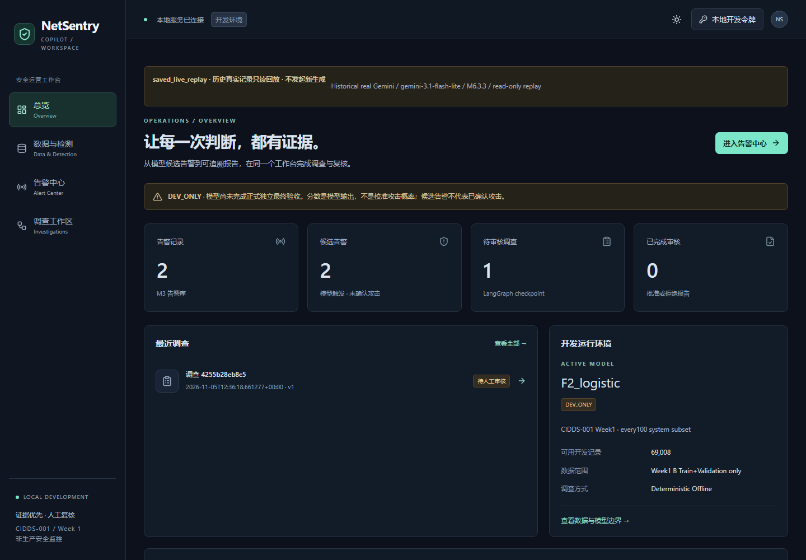
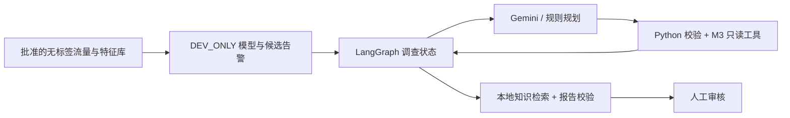

# NetSentry Copilot

**安全告警初步研判工作台：连接流量上下文、受控工具调查、证据报告与人工复核。**

[GitHub Pages 作品集](https://uangh.github.io/NetSentry-Copilot/) · [公开源码](https://github.com/uangh/NetSentry-Copilot) · [本地作品集](site/index.html) · [精简项目案例](site/PUBLIC_CASE_STUDY.html) · [GitHub 发布说明](GITHUB_PUBLISH.md)

GitHub Pages 已部署并完成桌面与手机浏览器检查，仅托管静态作品集。原 [Sites 作品集](https://netsentry-portfolio.verdantadage.chatgpt.site/) 仍可独立访问。



界面来自公开 CIDDS 开发子集的真实运行记录。本仓库展示历史截图；不包含截图对应的运行数据库或模型。产品需求是面向安全分析与复核人员的设计假设。个人贡献聚焦任务定义、产品取舍与验收，Codex 辅助实现。

## 核心能力

- CSV 质量审计、离线 PCAP 流提取、具备来源追溯的流记录查询。
- 离线标签与调查事件隔离，模型特征使用白名单。
- LangGraph 管理状态与预算；Gemini 根据已有观察选择获准工具。
- 本地 TF-IDF 知识检索、报告引用校验、待审核与人工复核流程。
- FastAPI 后端与 React 控制台，保留无需真实 LLM 的规则工作流。

真实 Gemini 3.1 案例中的三步是**一次运行的实际选择路径**，并非程序要求每次按固定顺序执行；该案例由规划预算结束。

## 简洁架构



`netsentry/` 为业务源码，`frontend/` 为本地控制台，`site/` 为独立静态作品集。GitHub Pages **只发布 site/**，不会运行 Python、模型或 Agent。

## 安装与运行

实测环境：Windows、Python 3.14、Node.js、pnpm。依赖采用现有固定版本和前端锁文件，其他环境需要自行验证。

### 1. 只看作品集：无需依赖、数据或密钥

直接用浏览器打开 `site/index.html`。项目案例入口是 HTML，中文编码已声明为 UTF-8。

### 2. 安装公开源码的依赖

在仓库根目录执行（PowerShell）：

```powershell
python -m venv .venv
./.venv/Scripts/python.exe -m pip install -r requirements-gemini.txt
./.venv/Scripts/python.exe -m pip check
pnpm --dir frontend install --frozen-lockfile
```

`requirements-gemini.txt` 是后端完整固定依赖入口；安装 SDK 不会调用 Gemini。其他 requirements 文件保留为模块依赖记录，不要将历史绘图依赖与完整入口混装。前端所需版本由 `frontend/pnpm-lock.yaml` 固定。

### 3. 无真实 LLM、无私有资产的验证

```powershell
./.venv/Scripts/python.exe scripts/run_public_tests.py
pnpm --dir frontend typecheck
pnpm --dir frontend test
pnpm --dir frontend build
./.venv/Scripts/python.exe -m netsentry.audit_csv sample_data/features_only.csv --provenance synthetic --out outputs/example_audit
```

`sample_data/` 全部为合成夹具。普通测试使用 Fake Gemini 和临时数据库，不代表真实攻击检测效果。测试入口屏蔽外部网络连接并清除密钥；详细范围见 [测试说明](docs/TESTING.md)。原模型拟合测试和资产依赖测试保留，但不属于本轮执行范围。

### 4. 启动前端页面

```powershell
pnpm --dir frontend dev
```

前端可独立编译和启动。使用告警、预测与调查功能时，请先连接后端并准备下文所列运行资产。

### 5. 准备资产后运行前后端

运行数据库与模型权重需单独准备。请从可信且获授权的来源取得 [运行资产契约](docs/RUNTIME_ASSETS.md) 所列文件。不要加载未经核验的 joblib/pickle。

```powershell
$env:NETSENTRY_RUNTIME_DIR = 'runtime/approved'
./.venv/Scripts/python.exe scripts/check_runtime.py
./.venv/Scripts/python.exe scripts/start_netsentry_dev.py --read-only
```

预检缺少资产时以非零状态退出，指出缺失文件，不进行模型加载或生成。完整启动需要这些资产。`--read-only` 可查看现有数据，不开放写入调查。

需实际创建告警、调查或提交审核时，在准备资产后运行 `scripts/start_netsentry_dev.py`（不加 `--read-only`），按本机隐藏输入配置至少24字符的本地写入令牌，并在控制台配置该令牌；它不是 Gemini Key。真实 Gemini 模式还需仅在后端进程环境中设置 `GEMINI_API_KEY`，显式选择对应模式才允许生成。普通验证不使用它。`.env.example` 只解释变量名，不会自动加载。

## 项目范围

本地研究原型，默认 `F2_logistic · DEV_ONLY`；模型分数不是校准攻击概率。关联流量不代表同一次攻击，引用存在不等于语义支持。缺少独立证据时保留 `insufficient_evidence`，报告需人工复核。

## 第三方来源与分发

[第三方说明](THIRD_PARTY_NOTICES.md) · [页面数据和素材署名](site/ATTRIBUTIONS.html) · [公开文件范围](docs/PUBLIC_EXPORT.md)

本仓库未给整个项目指定新的开源许可证；公开可查看不等于授予任意再分发许可。已有第三方许可保留，数据、图标与项目源码分别处理。
